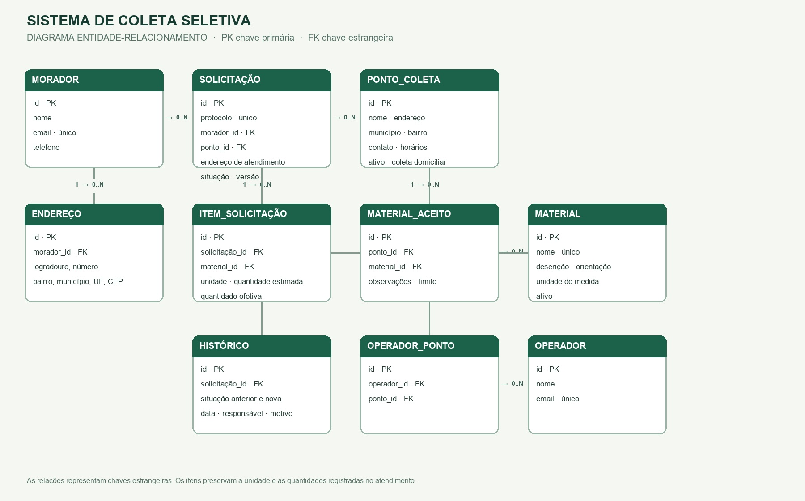

# Modelo, decisões e validação

## Modelo entidade-relacionamento
As associações abaixo representam chaves estrangeiras. Um ponto pode receber vários operadores e aceitar vários materiais.

O pedido guarda uma cópia do endereço e da unidade de cada item. A quantidade estimada é informada na criação. A quantidade efetiva é informada na conclusão. O resumo agrega por material e unidade histórica. O protocolo é único e o serviço valida versão, transição e vínculo dos itens dentro da transação.

Moradores podem ser cadastrados, consultados e atualizados. A chave estrangeira da solicitação protege o morador contra exclusão física. Pontos e materiais possuem inativação. Administradores e operadores são perfis de demonstração. Os cabeçalhos identificam o responsável registrado no histórico sem autenticar a identidade.

O catálogo pesquisa município e bairro em colunas próprias. Cadastros antigos que só têm endereço textual usam esse campo como alternativa até a atualização.

## Protótipo de navegação
| Área | Entrada | Fluxo |
|---|---|---|
| Pontos de coleta | Nome, município, bairro, material | Pesquisar → examinar horários, endereço e orientações → navegar entre páginas |
| Morador | Cadastro ou ID fictício | Editar perfil → cadastrar endereço → escolher ponto e itens → consultar protocolo, detalhes e histórico → corrigir ou cancelar quando permitido |
| Atendimento | Operador e ponto vinculado | Filtrar pedidos → abrir detalhes → agendar, recusar, iniciar, concluir ou registrar tentativa e reagendar |
| Administração | Cadastros e período | Editar e inativar, gerir vínculos e consultar totais por situação e material |

